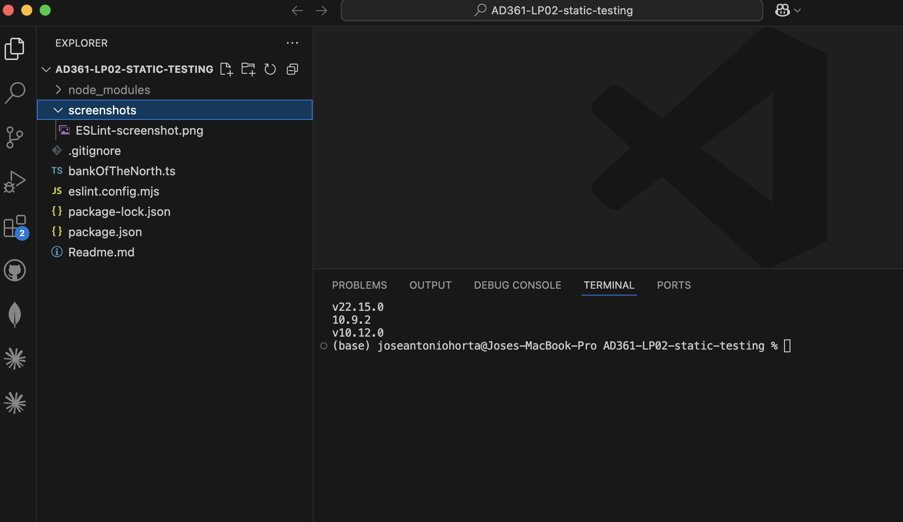

# Cross-Check and Automated Static Analysis — Working Draft

**Activity:** LP02 — Static Testing  
**Status:** Pending; not a completed submission.

This file contains the required review sections and reflection prompts. It does not claim that the final cross-check or automated analysis has been completed. Each member must add their own name and actual final review results.

## Group Members' Final Review Notes

### José Antonio Horta Herrera — Scribe

- **Review status:** Pending.
- **Required check:** Compare each entry in `issue_log.md` with `fixBankOfTheNorth.ts`, update the status according to the actual result, and identify any unresolved entries.
- **Final review note:** Pending — add after the corrected code has been reviewed.

### Ingrid Arenas - Reviewer

- **Review status:** Pending.
- **Required check:** const USER was assigned but never used, two options remove it or use it somewhere in a console message
- **Final review note:** Pending — reviewer to complete after their final review.

### Nha Pham - Author

- **Name:** Nha Pham
- **Review status:** Ongoing.
- **Required check:** Reviewed the issue log and corrected code for unresolved defects, while dicussing with group members.
- **Final review note:** Pending — author to complete after their final review.

## Evidence

The manual review must precede the automated-analysis comparison. Do not treat expected tool findings as observed results.

### ESLint installation

- **Command:** `npx eslint --version`
- **Installed ESLint version:** `v10.12.0`
- **Screenshot:** `screenshots/01-eslint-installed-jose.png`
- **Evidence status:** The screenshot shows the command and the installed ESLint version.

### Original source analysis

- **Command:** `npx eslint fixBankOfTheNorth.ts`
- **Screenshot:** screenshots\eslint-original.png
- **Observed results:** bankOfTheNorth has multiple issed where a variable is assigned but never used

### Corrected source analysis

- **Command:** `npx eslint fixBankOfTheNorth.ts`
- **Screenshot:** screenshots\eslint-fixed.png
- **Observed results:** Only one error with a variable being unused

## Reflection: Manual Review Compared with ESLint

### What did ESLint identify?

Pending — summarize actual messages from the original and corrected source runs. Identify which problems remained, disappeared, or were newly reported.

### What did the group identify that ESLint did not?

Pending — compare the confirmed manual-review findings with the actual diagnostics. Do not assume that a manual finding was missed by ESLint before checking the output.

### Did ESLint identify anything the group missed?

Pending — report any additional findings from the actual runs. If there were none, state that only after completing the comparison.

## Completion Check

Before submission, confirm that all members have added their names and final review notes; the issue-log statuses match the corrected code; all three screenshot requirements are satisfied; the reflection is based on actual outputs; and the required files are present in the public repository. Every group member must submit the same repository URL on Canvas.
